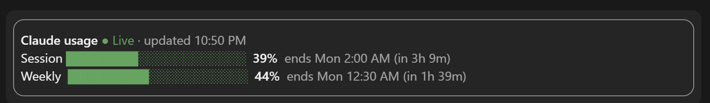

# usage-card



A Claude Code mod that draws a card above the prompt with your Claude
subscription usage: the 5-hour session window and the 7-day weekly window,
each as a bar with the percentage used, when it resets and how long is left.

- **● Live**: read every minute from the account's usage endpoint, using the
  session's own subscription login. It counts every session and claude.ai.
- **○ From last reply**: when the live read is out of reach (for example with
  an API key instead of a subscription), the figures from the last reply's
  headers are shown instead.

Type `/usage-card` to hide or show the card.

## Install

At the prompt of a Claude Code terminal session:

```
/plugin install usage-card --marketplace arunmuthuganesh/usage-card
```

Answer `y` to add the marketplace, then press Enter to pick the user scope.

From a shell:

```
claude plugin install usage-card --marketplace arunmuthuganesh/usage-card
```

In the desktop app, where `/plugin` does not run: click + next to the prompt
box, then Plugins, Add marketplace with `arunmuthuganesh/usage-card`, then Add plugin.

## Notes

- The latest reading is also written to
  `~/.claude/delegation-state/balance-cache.json` (key `usageCardLimits`) so
  other local tools can read it.

## License

MIT
